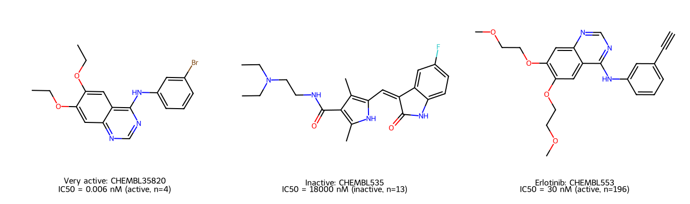
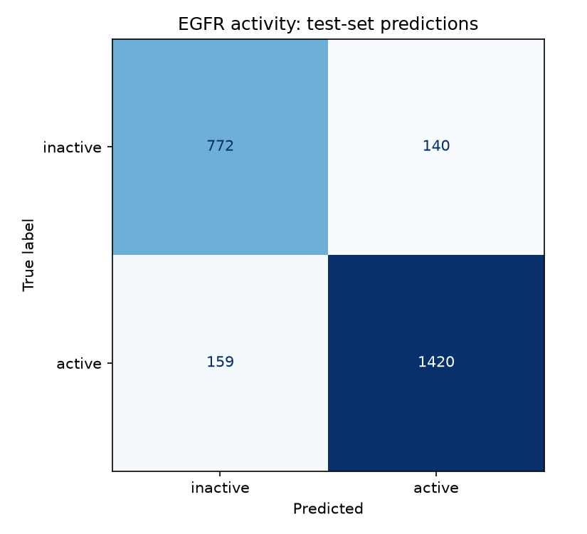
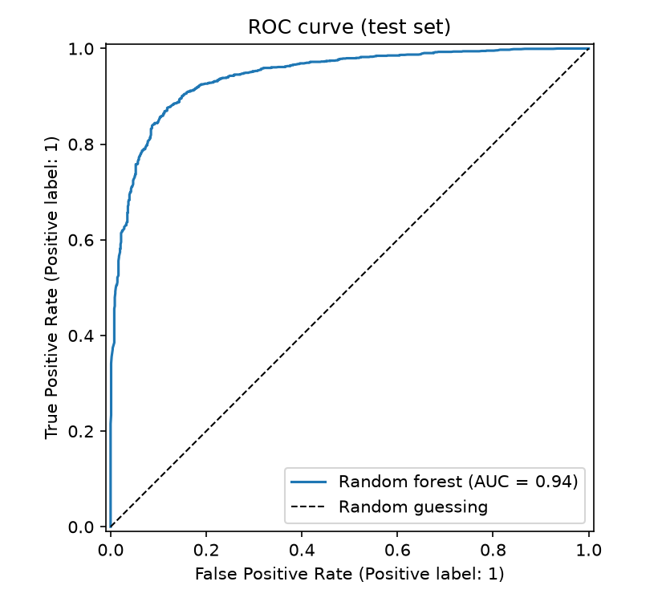

# Predicting EGFR inhibition from chemical structure

A model that predicts whether a molecule could block a lung-cancer protein, and
an honest look at how well it really works.

A machine-learning model that predicts whether a small molecule inhibits the
epidermal growth factor receptor (EGFR), trained on 12,455 compounds with
measured IC50 values from ChEMBL. A random forest over Morgan fingerprints
reaches **88.0% accuracy (ROC-AUC 0.941)** under a conventional random
train/test split. But that number is inflated by near-identical compounds
appearing on both sides of the split. Under a **Bemis–Murcko scaffold split**,
where entire chemical series are held out so the test molecules belong to
classes the model has never seen, performance drops to **79.6% accuracy
(ROC-AUC 0.866)**. The scaffold number is the honest one, and the gap between
the two is the most interesting result in this project.

**Start here:** [`notebooks/egfr_analysis.ipynb`](notebooks/egfr_analysis.ipynb)
walks through the whole project end to end, with the data, the figures and the
experiments in order and explained for a non-specialist reader. It renders
directly on GitHub, with all outputs saved.

## The question

Given only a molecule's 2D structure, can we predict whether it inhibits EGFR
at a useful potency (IC50 < 1 µM)?

EGFR is a receptor tyrosine kinase that drives cell proliferation. Activating
mutations in *EGFR* are a major oncogenic driver in non-small-cell lung cancer,
and the receptor is one of the most successfully drugged targets in oncology:
gefitinib, erlotinib, afatinib, osimertinib and lapatinib are all approved EGFR
inhibitors. It is therefore unusually well characterised in public data, which
makes it a good target for building and honestly stress-testing a
structure–activity model.

## Data

**Source:** [ChEMBL](https://www.ebi.ac.uk/chembl/) target `CHEMBL203` (human
EGFR), retrieved via `chembl_webresource_client` from ChEMBL_37 (released
2026-05-01) in November 2026. 25,244 IC50 measurements reported in nM; 25,083
retained after discarding records with no structure or no value.

**Cleaning** (`scripts/clean_and_label.py`). The raw data needed more care than
expected:

- **Qualifiers matter.** ChEMBL records whether a value is exact (`=`) or a
  limit (`>`, `<`). Exact values are kept; `>` values are kept only when they
  already prove inactivity (≥ 1 µM). `<` values are discarded, since they
  cannot be placed either side of the cutoff.
- **Physically impossible values were present.** 106 `>` and 49 `=` records
  exceeded 1 mM, some as high as 0.8 M. Most are unit errors: the same compound
  appears at, say, 5,220 nM and again at 5,220,000 nM. All values above 1 mM
  are dropped. Left in, they corrupted labels. One compound with five exact
  measurements between 6 and 1,200 nM was being labelled *inactive* because six
  impossible `>` entries outvoted them in the median.
- **Exact values take precedence.** Where a compound has any `=` measurement,
  only those are used; `>` values are used only for compounds that have no
  exact measurement at all.
- **Replicates are merged by median**, which resists the order-of-magnitude
  outliers that are common across assays and laboratories.

**Result:** 12,455 unique compounds: 7,897 active (63.4%) and 4,558 inactive
(36.6%) at a 1 µM cutoff.

## Method

Each molecule is encoded as a **Morgan fingerprint** (radius 2, 2,048 bits, via
RDKit): a binary vector recording which local atomic environments are present,
roughly 61 bits set per molecule. A **random forest** (500 trees,
`class_weight="balanced"`) is trained on these fingerprints.



Two splitting strategies are compared: a stratified random 80/20 split, and a
scaffold split in which molecules are grouped by Bemis–Murcko scaffold (the
ring system with side chains stripped) so that every member of a chemical
series lands entirely in training or entirely in test.

## Results

| | Random split | Scaffold split |
|---|---|---|
| Accuracy | 88.0% | **79.6%** |
| ROC-AUC | 0.941 | **0.866** |
| Recall, active | 89.9% | 85.4% |
| Recall, inactive | 84.6% | 72.6% |
| Majority-class baseline | 63.4% | 54.4% |

Figures below are for the random split (`scripts/evaluate_model.py`):




The model is clearly learning real structure–activity relationships. Both
splits beat their baselines by more than 20 points. But roughly 8 points of
accuracy and 0.075 of ROC-AUC in the random split come from chemical similarity
leaking across the train/test boundary.

## Three experiments

**1. Holding out the approved drugs** (`experiment_holdout_drugs.py`). The
model scores all five approved EGFR inhibitors ≥ 0.98, but all five were in its
training data, so this proves nothing. Retraining with them removed, all five
are still predicted active. **However, measuring each drug's nearest remaining
training neighbour revealed hidden duplicates:** afatinib's *opposite
enantiomer* (Tanimoto 1.00, because Morgan fingerprints ignore stereochemistry,
so it is literally the same input vector), erlotinib's *hydrochloride salt* (0.98),
and osimertinib's *deuterated analogue* (0.91). Removing a compound by ChEMBL
ID does not remove it from the training set. This was the finding that
motivated the scaffold split.

**2. Scaffold split** (`experiment_scaffold_split.py`). Grouping 12,455
molecules into 4,500 scaffolds and splitting by series gives the honest
estimate above: 88.0% → 79.6% accuracy, 0.941 → 0.866 ROC-AUC.

**3. Class weighting** (`experiment_class_weight.py`). On the scaffold split,
`class_weight="balanced"` raises inactive recall from 62.4% to 72.6% at a cost
of 3.7 points of active recall. Notably **ROC-AUC is unchanged** (0.868 →
0.866): the setting improves where the decision threshold sits, not what the
model knows. It was adopted because false positives are the expensive error in
screening triage.

## Limitations

- **2D structure only.** Fingerprints capture which substructures are present,
  not conformation, binding mode or selectivity across kinases.
- **A single potency cutoff.** 1 µM is conventional but arbitrary; compounds
  near the boundary are effectively coin flips.
- **Publication bias.** 63% of the dataset is active, because medicinal
  chemistry papers report series around compounds that worked. True inactives
  are underrepresented and chemically diverse, which is why inactive recall is
  the weaker half of every result here.
- **Aggregated across assays.** IC50 values are pooled from many laboratories
  and assay formats; the median mitigates this but does not remove it.
- **Applicability domain.** Predictions for molecules unlike the training data
  are unreliable, which is why `predict_drugs.py` reports nearest-neighbour
  similarity alongside every score.

## What I would do next

- Add physicochemical descriptors (logP, TPSA, molecular weight) alongside the
  fingerprint bits, since class weighting did not move ROC-AUC, so further gains
  need genuinely new information rather than recalibration.
- Deduplicate by canonical parent structure (InChIKey) to remove the salt,
  isotope and stereoisomer twins found in experiment 1.
- Regression on pIC50 instead of binary classification, to avoid discarding
  potency information at the cutoff.
- Benchmark against a chemistry-aware baseline such as a graph neural network.

## Running it

Requires [uv](https://docs.astral.sh/uv/). Python 3.14 and all dependencies are
installed automatically:

```bash
uv sync
```

The guided walkthrough, which reproduces everything below from the committed
data in about three minutes and needs no internet connection:

```bash
uv run jupyter lab notebooks/egfr_analysis.ipynb
```

Or run the pipeline from the command line:

```bash
uv run python scripts/download_egfr_ic50.py   # fetch IC50 data from ChEMBL (~8 min)
uv run python scripts/clean_and_label.py      # clean, merge replicates, label
uv run python scripts/make_fingerprints.py    # Morgan fingerprints + example figure
uv run python scripts/train_model.py          # train the random forest
uv run python scripts/evaluate_model.py       # metrics + figures

uv run python scripts/experiment_holdout_drugs.py
uv run python scripts/experiment_scaffold_split.py
uv run python scripts/experiment_class_weight.py
```

Predict any molecule from the command line:

```bash
uv run python scripts/predict_drugs.py "CC(=O)Oc1ccccc1C(=O)O"
uv run python scripts/predict_drugs.py --csv compounds.csv --name-column compound_id
uv run python scripts/predict_drugs.py          # sanity check on 9 known drugs
```

Every prediction reports the Tanimoto similarity to the nearest training
molecule and warns when a compound falls outside the model's applicability
domain.

Trained models are not committed; rebuild them with `train_model.py`. Note that
`pyproject.toml` pins an RDKit version with Intel-macOS wheels.

**Stack:** Python 3.14 · RDKit · scikit-learn · pandas · NumPy · matplotlib ·
chembl_webresource_client · uv

## Licence and citation

The source code in `scripts/` and the documentation are released under the
[MIT licence](LICENSE).

The data files in `data/` are **not** MIT licensed. Bioactivity data are from
ChEMBL, released under a
[Creative Commons Attribution-ShareAlike 3.0 Unported licence](https://creativecommons.org/licenses/by-sa/3.0/)
(CC BY-SA 3.0). The derived files in `data/` are adaptations of ChEMBL content
and are redistributed under that same ShareAlike licence, so any reuse of them
must be attributed and shared alike. See [data/LICENSE](data/LICENSE).

> Zdrazil B, Felix E, Hunter F, Manners EJ, Blackshaw J, Corbett S,
> de Veij M, Ioannidis H, Mendez Lopez D, Mosquera JF, Magarinos MP,
> Bosc N, Arcila R, Kizilören T, Gaulton A, Bento AP, Adasme MF,
> Monecke P, Landrum GA, Leach AR. The ChEMBL Database in 2023: a drug
> discovery platform spanning multiple bioactivity data types and time
> periods. *Nucleic Acids Research* 2024;52(D1):D1180–D1192.
> doi:[10.1093/nar/gkad1004](https://doi.org/10.1093/nar/gkad1004)

---

*Built with Claude Code, which wrote most of the code and surfaced several
findings (the impossible ChEMBL values and hidden duplicates). I directed the
project, chose between approaches, and checked and interpreted the results.*
